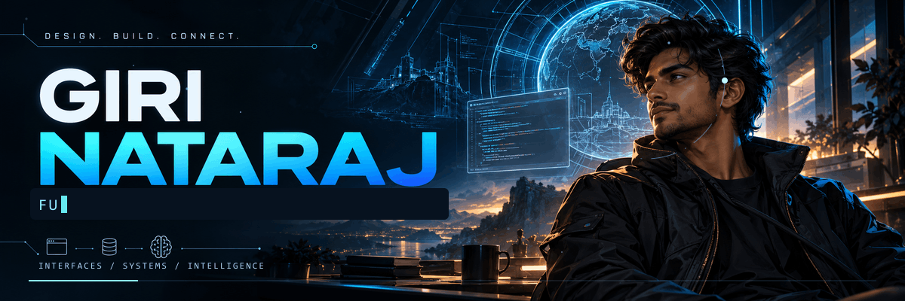
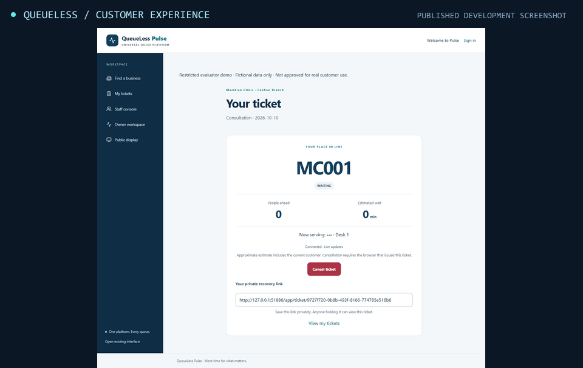

  
  

  &nbsp;
  &nbsp;
  &nbsp;
  

<h3 align="center">I build the interface. Then I build what it runs on.</h3>

React & TypeScript interfaces · Python & Node.js services · AI that connects information to action

 

I’m **Giri Nataraj**, an Information Technology student and developer from **Erode, India**. I’m interested in the whole path from a useful interface to the services, data, and decisions behind it.

My current work spans **business queue systems**, **RAG and MCP-based assistants**, and **thoughtfully designed web products**.

 

| Layer | Tools I work with |
| :--- | :--- |
| **Interface** |  &nbsp;  &nbsp;  &nbsp;  React · Next.js · TypeScript · Tailwind CSS |
| **Services** |  &nbsp;  &nbsp;  &nbsp;  Python · Node.js · C# · .NET |
| **Data** |  &nbsp;  &nbsp;  &nbsp;  PostgreSQL · MongoDB · SQLite · Prisma |
| **Build & verify** |  &nbsp;  &nbsp;  &nbsp;  Git · Docker · Vitest · Playwright |

 

## Selected work

### QueueLess Pulse

**A multi-business virtual queue platform** connecting customers, staff, owners, and reception displays.

| Product experience | Engineering underneath |
| :--- | :--- |
| QR entry and ticket tracking Staff call / complete / skip controls Owner business and team management Public reception displays | Business-scoped memberships and permissions PostgreSQL service-row locking Ticket transitions with event history React frontend over the Flask API |

`React` `TypeScript` `Flask` `PostgreSQL`

**[Explore repository ↗](https://github.com/girinataraj/QueueLess-Pulse)** · [Architecture & verification ↗](https://github.com/girinataraj/QueueLess-Pulse/blob/main/docs/FRONTEND_VERIFICATION.md)

<b>Play the four-interface tour ↗</b>

 

Animated carousel of published development screenshots. The cover above is an animated concept diagram.

 

### CloseFuture AI Assistant

**An AI assistant case study** combining grounded answers, intent routing, discovery-call scheduling, and lead summaries.

| Conversational workflow | Engineering underneath |
| :--- | :--- |
| Retrieve source-backed studio information Route search and booking requests Find calendar slots and arrange calls Prepare lead summaries | Vector retrieval with source citations Separate orchestration and agent responsibilities Calendar and Email MCP servers Session state and duplicate-send protection |

`TypeScript` `React` `Node.js` `pgvector` `MCP`

**[Explore repository ↗](https://github.com/girinataraj/closefuture-agent)** · [System architecture ↗](https://github.com/girinataraj/closefuture-agent#1-system-architecture)

 

### Sacred Commerce

**An independent fictional storefront and product ownership case study**, with original editorial design and Light / Moonlight themes.

| Shopping experience | Product and engineering decisions |
| :--- | :--- |
| Browse, search, filter, and sort products Guest cart with local recovery Validated simulated checkout Responsive Light / Moonlight interface | Explicit demo scope and system boundaries Documented architecture and trade-offs Keyboard access and visible focus Unit and browser verification suites |

`Next.js` `TypeScript` `Tailwind CSS` `Prisma` `Playwright`

**[Explore repository ↗](https://github.com/girinataraj/sacred-commerce)** · [Product case study ↗](https://github.com/girinataraj/sacred-commerce/blob/main/docs/product-owner/case-study.md)

Independent fictional demo. No affiliation with Isha Foundation or Isha Life. Checkout is simulated.

 

### More from the workshop

<table>
<tr>
<td width="50%" valign="top">
<h3>⌘ Résumé RAG</h3>

A conversational interface over résumé information.

React chat UI · Python retrieval pipeline · Chroma similarity search · LangChain orchestration.

<a href="https://github.com/girinataraj/Resume-RAG-Application"><b>Inspect the build ↗</b></a>

</td>
<td width="50%" valign="top">
<h3>✦ Crown Dental Clinic</h3>

A React and TypeScript clinic website interface.

Treatment routes · Doctor and clinic sections · Gallery · Consultation and contact flows.

<a href="https://github.com/girinataraj/Crown-Dental-Clinic"><b>Inspect the build ↗</b></a>

</td>
</tr>
</table>

 

| Chapter | Focus |
| :--- | :--- |
| **2023–2027 · Information Technology** | B.Tech at Nandha Engineering College, Erode. |
| **2024–2025 · Application projects** | Vehicle and student management interfaces; React, TypeScript, and C# backend work. |
| **Jun–Jul 2025 · AST Technologies** | Internship in Google Workspace extension testing, web workflows, and usability evaluation. |
| **Current build direction** | Full-stack products, retrieval-augmented generation, and tools connected through MCP. |

 

<b>Latest public code pushes ↗</b>

 

Generated daily from public GitHub data. Project counts exclude forks, archives, and this profile repository. Language bars count repositories, not proficiency. Active days reflect the public profile calendar, which can include anonymized private activity if enabled. Dates describe pushes, not releases. Scheduled refresh begins after merge and may be delayed by GitHub.

 

  <a href="mailto:girinataraj765@gmail.com"><b>GIRINATARAJ765@GMAIL.COM ↗</b></a>
  &nbsp; / &nbsp;
  <a href="https://www.linkedin.com/in/girins/"><b>CONNECT ON LINKEDIN ↗</b></a>

Erode, India · interfaces / systems / applied AI

