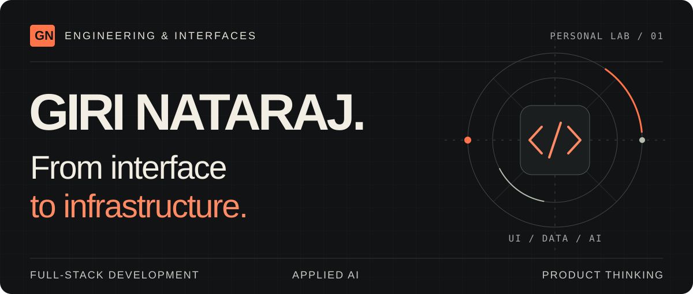
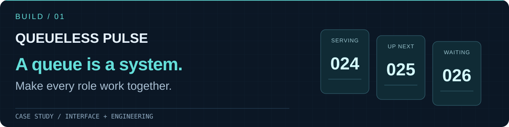
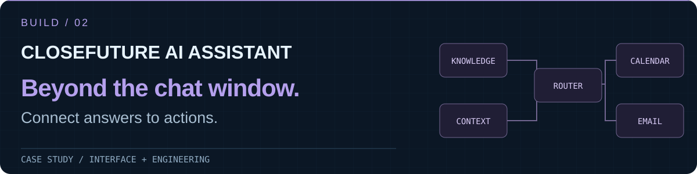
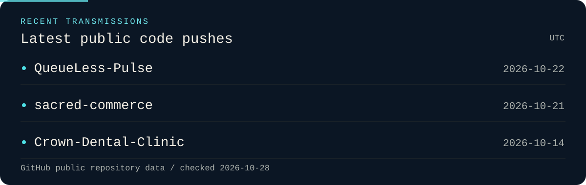

  

  <a href="#selected-builds"><b>EXPLORE THE BUILDS ↓</b></a>
  &nbsp;&nbsp; / &nbsp;&nbsp;
  <a href="https://www.linkedin.com/in/giri765/"><b>LINKEDIN ↗</b></a>
  &nbsp;&nbsp; / &nbsp;&nbsp;
  <a href="mailto:girinataraj765@gmail.com"><b>LET’S TALK ↗</b></a>

 

### Good interfaces invite people in. Good systems keep things working.

I’m **Giri Nataraj**. I build across the stack: React and TypeScript interfaces, Python and Node.js services, and AI workflows that connect information to action.

My work explores the parts behind the screen: queue state, access boundaries, retrieval, scheduling, and the decisions that turn an idea into a usable product.

 

## Selected builds

### 01 / QueueLess Pulse

**A virtual queue platform for businesses with people waiting.** QR entry, ticket tracking, staff controls, owner management, and reception displays share one queue model.

The engineering: business-scoped permissions, PostgreSQL service-row locking, and an event history behind each ticket transition.

`React` `TypeScript` `Flask` `PostgreSQL`

[Explore the code ↗](https://github.com/girinataraj/QueueLess-Pulse) · [Frontend architecture & verification ↗](https://github.com/girinataraj/QueueLess-Pulse/blob/main/docs/FRONTEND_VERIFICATION.md)

See an actual interface

 

*Project screenshot from the repository; this is a development preview.*

 

### 02 / CloseFuture AI Assistant

**An AI assistant case study that connects answers to actions.** Grounded retrieval, intent routing, calendar scheduling, and lead summaries meet in one conversational interface.

The engineering: source citations, separate agent responsibilities, Calendar and Email MCP servers, and session state for duplicate-send protection.

`TypeScript` `React` `Node.js` `pgvector` `MCP`

[Explore the code ↗](https://github.com/girinataraj/closefuture-agent) · [Architecture & walkthrough ↗](https://github.com/girinataraj/closefuture-agent#1-system-architecture)

 

### 03 / Sacred Commerce

**An independent, fictional storefront and product ownership case study.** Original editorial design, product discovery, a recoverable guest cart, and a simulated checkout, with Light and Moonlight themes.

The product work: explicit scope, documented trade-offs, accessibility, and measurable hypotheses alongside the implementation.

`Next.js` `TypeScript` `Tailwind CSS` `Prisma` `Playwright`

[Explore the code ↗](https://github.com/girinataraj/sacred-commerce) · [Product decisions ↗](https://github.com/girinataraj/sacred-commerce/blob/main/docs/product-owner/case-study.md)

Independent fictional demo. No affiliation with Isha Foundation or Isha Life. Checkout is simulated.

 

## My working set

| Interface | Services & data | Applied AI | Quality |
| :--- | :--- | :--- | :--- |
| React · Next.js | Python · Flask | Retrieval-augmented generation | Vitest · Playwright |
| TypeScript · Tailwind CSS | Node.js · PostgreSQL | Vector search · MCP | Access boundaries · clear contracts |

 

## In the workshop

Generated daily from public repository metadata. Dates describe code pushes, not releases; forks, archived repositories, and this profile repository are excluded. GitHub may delay scheduled updates.

 

---

### Have something worth building?

[Show me the problem. Let’s talk. ↗](mailto:girinataraj765@gmail.com)

Giri Nataraj · interfaces / systems / applied AI
